<div align="center">

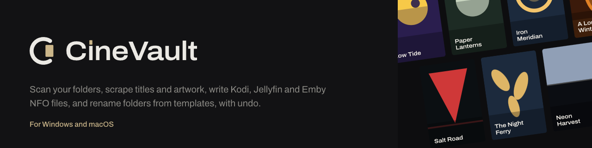

# CineVault

[English](README.en.md) · **Français**

> CineVault FR est un fork indépendant de [CineVault](https://github.com/mustafayevt/CineVault) par mustafayevt (Apache-2.0), avec une interface en français et une étape « dossier » lors du Scrape.

**Un gestionnaire de bibliothèque de bureau rapide, gratuit et open source pour vos films et séries, pour Windows et Linux (bêta).**

[](https://github.com/imtheyoyo/CineVault-FR/releases/latest)
[](https://github.com/imtheyoyo/CineVault-FR/actions/workflows/ci.yml)
[](LICENSE)

**[Télécharger CineVault](https://imtheyoyo.github.io/CineVault-FR/)** · [Toutes les versions](https://github.com/imtheyoyo/CineVault-FR/releases) · [Journal des modifications](CHANGELOG.md)

</div>

<p align="center">
  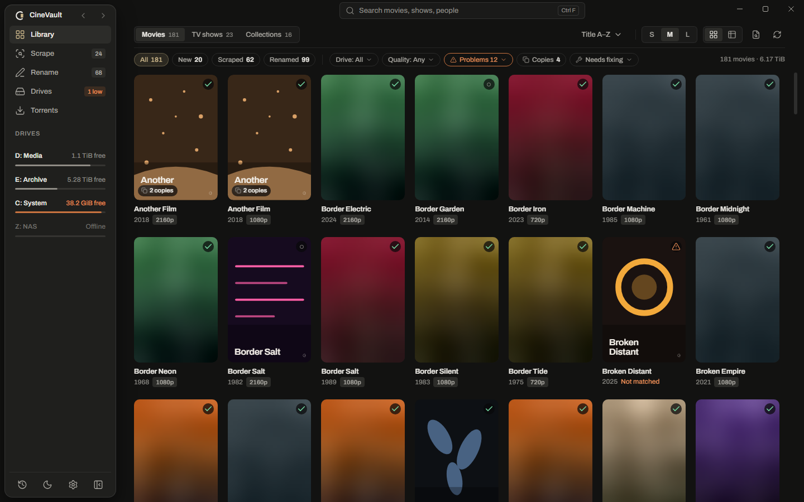
</p>

## Ce que fait CineVault

- **Scanner → Scraper → Renommer.** Chaque titre passe par trois étapes : Nouveau, Scrapé, Renommé. Le scan trouve les films et séries de vos dossiers, le Scrape identifie chacun en ligne, Renommer range dossiers et fichiers à partir d'un modèle.
- **NFO et illustrations pour Kodi, Jellyfin et Emby.** Chaque Scrape écrit des fichiers NFO complets et tous les types d'illustrations (affiche, fanart, logo, clearart, bannière, disque, vignette) dans les formats lus par votre centre multimédia.
- **Séries.** Pages de série, de saison et d'épisode, avec les épisodes manquants ou pas encore diffusés, les spéciaux et les illustrations de saison.
- **Notes côte à côte.** TMDB et IMDb sans clé, plus Rotten Tomatoes, Metacritic, Letterboxd et Trakt avec votre propre clé gratuite OMDb ou MDBList.
- **Recherche au fil de la frappe.** Tapez dans la zone de recherche : les titres correspondants apparaissent aussitôt, regroupés, avec vos recherches récentes et « Voir tous les résultats ». La ponctuation, les espaces, les accents et les petites fautes de frappe n'ont pas d'importance ; les noms de release désordonnés correspondent quand même, avec un score de confiance pour chaque candidat.
- **Une bibliothèque à votre façon.** Une grille d'affiches de la taille de votre choix, ou un tableau avec une colonne Étape dont les colonnes se déplacent et se redimensionnent. Le filtre « À corriger » liste les titres sans affiche, sans fanart, sans logo clear ou sans synopsis, ou pas encore scrapés, pour les corriger d'un coup.
- **Copies d'un film.** Si le même film est deux fois dans la bibliothèque (par exemple un téléchargement 4K et un 1080p), le filtre Copies les liste, la page du film a un onglet par copie, Comparer les met côte à côte en marquant la meilleure valeur de chaque ligne, et « Garder celle-ci » supprime l'autre comme le fait toujours Supprimer. « Garder les deux » n'y touche pas, et Renommer donne à chacune son propre nom, par exemple `- 2160p` et `- 1080p`.
- **Détails HDR.** La carte Technique indique le format HDR exact (profil Dolby Vision, HDR10+, HDR10, HLG), ainsi que l'audio et les détails du fichier lus dans le fichier.
- **Disques et déplacements sûrs.** Espace libre par disque et « Déplacer vers un autre disque » : copie, vérification, et seulement ensuite les originaux partent à la Corbeille (la corbeille de Linux). « Scanner ce dossier » et « Scanner à nouveau » lisent un dossier de bibliothèque ou un titre au lieu de tous les disques, et un scan compte en titres avec le temps restant.
- **Fichiers supprimés comme vous le voulez.** Supprimer envoie un titre à la Corbeille, dans un dossier de corbeille sur chaque disque ou dans un dossier de corbeille de votre choix, et l'ancienne corbeille peut être vidée automatiquement. Choisir « Supprimer définitivement » dans les paramètres fait effacer le titre par Supprimer, après un Oui ou Non qui liste ce qui part.
- **Activité, Historique et Annuler.** Les renommages, déplacements, suppressions, changements d'illustrations et de correspondance sont listés dans l'Historique de la page Activité, chacun avec Annuler. Tout ce qui demande votre attention, comme un déplacement inachevé ou une clé d'API refusée, attend au-dessus dans « À traiter » avec sa solution.
- **Collections.** Une collection apparaît d'elle-même dès que vous possédez au moins deux films d'une même série.
- **Transmission de la recherche de torrents.** Choisissez un titre dans les suggestions, cherchez ses releases depuis l'application, affinez-les par des mots de leurs noms (`remux atmos -x265`) et comparez chacune avec ce que vous avez, côte à côte ; pour une série, voyez quelles releases comblent vos épisodes manquants. CineVault transmet celle que vous choisissez à votre propre client torrent. Vous êtes responsable de ce que vous téléchargez et partagez.
- **Liste de souhaits.** Ajoutez un film, une saison ou le prochain nouvel épisode d'une série avec la release voulue (résolution, source, HDR, fourchette de taille, seeders). CineVault la recherche à l'ouverture, affiche les nouvelles correspondances dans Torrents avec un compteur, et marque le titre comme terminé dès qu'une copie conforme à votre demande arrive. Un titre que vous avez déjà continue d'être vérifié, avec ce que vous possédez affiché sur son entrée. Rien n'est jamais envoyé automatiquement.
- **Confort de bureau.** Thèmes clair et sombre qui suivent le système, zoom de 80 % à 150 %, combinaisons de touches pour les actions courantes et une ligne de commande `cinevault`.
- **Styles de nommage.** Un seul contrôle Style dans Paramètres › Nommage (Clean, Detailed, Media-server safe, Release info) remplit les modèles du dossier de film, du fichier de film et de l'épisode de série ; modifiez-les pour créer le vôtre. Les jetons de release conservent le groupe de release, les étiquettes et la qualité du nom du téléchargement. Le commutateur « Métadonnées uniquement » ne touche à aucun nom de fichier ni de dossier et n'écrit que les NFO et les illustrations ; « Renommer après le scraping » (désactivé par défaut) renomme un titre dès qu'il est scrapé lorsque ses nouveaux noms conviennent, avec Annuler. Chaque titre peut utiliser son titre original ou son titre localisé, et vous choisissez les noms de fichier de chaque type d'illustration (`poster.jpg`, `folder.jpg`, le nom du film devant, ou plusieurs à la fois).
- **Confidentialité dès la conception.** Vous apportez vos propres clés de fournisseurs, conservées dans le magasin d'identifiants du système (le trousseau du système sous Linux). Pas de compte, pas de télémétrie.
- **Dossier créé au Scrape (nouveau dans CineVault FR).** Pour un film « en vrac », un Scrape crée d'abord un dossier propre au film, y déplace le fichier, puis y écrit le NFO et les illustrations, avec Annuler. Le réglage « Créer un dossier pour les fichiers en vrac » est dans Paramètres › Nommage.
- **Interface en français (nouveau dans CineVault FR).** Paramètres › Général › Langue de l'interface propose « Suivre le système » (par défaut), English et Français.

## Pour commencer

1. **Installer.** Téléchargez l'installateur depuis le [site](https://imtheyoyo.github.io/CineVault-FR/) ou la [page des versions](https://github.com/imtheyoyo/CineVault-FR/releases). Les versions Windows ne sont pas encore signées : SmartScreen (« Informations complémentaires », puis « Exécuter quand même ») affiche un avertissement au premier lancement.
   - **Linux (bêta, 64 bits) :** Ubuntu 22.04 ou plus récent, Fedora 38 ou plus récent. L'AppImage demande FUSE 2 (`libfuse2t64` sous Ubuntu 24.04) : `chmod +x CineVault-x86_64.AppImage`, puis ouvrez-la ; elle se met à jour depuis l'application. Ou installez le `.deb` (`sudo apt install ./CineVault-amd64.deb`) ou le `.rpm` (`sudo dnf install ./CineVault-x86_64.rpm`). Si la fenêtre reste vide avec certains pilotes graphiques, lancez CineVault avec `WEBKIT_DISABLE_DMABUF_RENDERER=1`.
   - **macOS :** une version est prévue.
2. **Ajoutez vos dossiers et une clé TMDB gratuite.** L'écran de premier lancement demande où sont vos films et séries, puis une [clé d'API TMDB](https://www.themoviedb.org/settings/api) (gratuite ; la seule clé nécessaire pour Scraper). Un dossier sur un NAS qui demande son propre nom d'utilisateur et mot de passe s'ajoute avec **Partage réseau…** à côté de **Ajouter un dossier…** ; CineVault garde le mot de passe dans le magasin d'identifiants de votre système.
3. **Scanner, Scraper, Renommer.** Le scan démarre tout seul. Scrapez vos titres, vérifiez l'aperçu du renommage, appliquez. Tout peut être annulé depuis l'Historique.

## Sauvegardes

Votre bibliothèque, son Historique et tout ce dont Annuler a besoin se trouvent dans `library.db`, dans le dossier de données de CineVault (`%APPDATA%\CineVault` sous Windows, `~/.local/share/CineVault` sous Linux, le dossier `data` à côté d'une copie portable, ou le dossier choisi dans les Paramètres). Pendant que CineVault tourne, il en garde chaque jour une copie vérifiée dans le dossier `backups`, sous la forme `library-AAAA-MM-JJ.db`, et conserve les sept dernières. Si les sauvegardes échouent trois jours de suite, Activité vous le signale.

Pour en restaurer une :

1. Quittez CineVault (ou arrêtez le serveur).
2. Dans le dossier de données, renommez `library.db` en `library-before-restore.db`, et mettez de côté `library.db-wal` et `library.db-shm` s'ils existent.
3. Copiez `backups/library-AAAA-MM-JJ.db` dans le dossier de données sous le nom `library.db`.
4. Démarrez CineVault.

La bibliothèque, l'Historique et Annuler reviennent à ce jour-là. Les fichiers renommés ou déplacés depuis sont retrouvés par le scan suivant, mais ces changements ne peuvent plus être annulés depuis CineVault. Pour revenir où vous étiez, échangez les fichiers de la même façon.

## L'utiliser dans un navigateur (bêta)

Utilisez votre bibliothèque depuis n'importe quel téléphone, tablette, téléviseur ou ordinateur de la maison. Sur un téléphone ou une tablette, la mise en page s'adapte à l'écran, et vous pouvez ajouter CineVault à l'écran d'accueil pour l'ouvrir comme une application.

**Le plus simple : l'Accès navigateur dans l'application de bureau** (Windows et Linux). Installez CineVault comme d'habitude, ouvrez **Paramètres › Accès navigateur**, définissez un mot de passe et activez-le. CineVault affiche une adresse comme `http://192.168.1.20:8787` et un code QR ; ouvrez-la sur n'importe quel appareil de votre réseau domestique. Rien d'autre à installer. Sous Windows, choisissez **Autoriser** quand le pare-feu le demande la première fois. En option, CineVault reste actif dans la zone de notification quand vous fermez la fenêtre et démarre à l'ouverture de session.

**Ou lancez-le comme un serveur** sur l'ordinateur qui contient vos films (un NAS, un mini-PC ou un PC toujours allumé), pour qu'il fonctionne sans session de bureau. Choisissez la méthode qui vous convient ; chacune tient en une commande, et la relancer met CineVault à jour, change ses dossiers ou le supprime.

**Linux** (Ubuntu 22.04, Debian 12, Fedora 36 ou plus récent ; 64 bits) : installe le paquet `cinevault-server` et le démarre comme un service.

```sh
curl -fsSL https://imtheyoyo.github.io/CineVault-FR/install.sh | sh
```

**Windows** (avec [Docker Desktop](https://docs.docker.com/desktop/setup/install/windows-install/) installé et lancé) : collez dans PowerShell.

```powershell
irm https://imtheyoyo.github.io/CineVault-FR/install.ps1 | iex
```

**macOS** (avec [Docker Desktop](https://docs.docker.com/desktop/setup/install/mac-install/) installé et lancé) : collez dans le Terminal.

```sh
curl -fsSL https://imtheyoyo.github.io/CineVault-FR/install.sh | sh
```

**NAS et Docker :** un [modèle Unraid](packaging/unraid/cinevault.xml), un [fichier Compose](docker-compose.yml) pour Synology, TrueNAS et autres, et l'image `ghcr.io/imtheyoyo/cinevault-fr` ([mode d'emploi](packaging/README.fr.md#installation-manuelle-avec-docker)).

L'installateur demande vos dossiers de films et de séries, démarre CineVault et ouvre `http://localhost:8787` ; il affiche aussi l'adresse à utiliser depuis les autres appareils. Ensuite :

1. **Choisissez un mot de passe** sur la page d'accueil, depuis n'importe quel appareil de votre réseau domestique. Elle reste affichée tant qu'aucun mot de passe n'est défini. Mot de passe oublié plus tard ? **Mot de passe oublié ?** sur la page de connexion vous donne un code PIN à usage unique dans le dossier de données de CineVault ([comment faire](packaging/README.fr.md#utilisation-au-quotidien)).
2. **Ajoutez vos dossiers** dans la configuration. Sous Linux, ils gardent leurs chemins habituels. Avec Docker, ils apparaissent sous `/media/` : par exemple votre `D:\Movies` devient `/media/Movies` ; l'installateur affiche la liste.
3. **Saisissez votre [clé TMDB](https://www.themoviedb.org/settings/api) gratuite** et lancez un scan.

<picture>
  <source srcset="site/img/server-login-light.webp" media="(prefers-color-scheme: light)">
  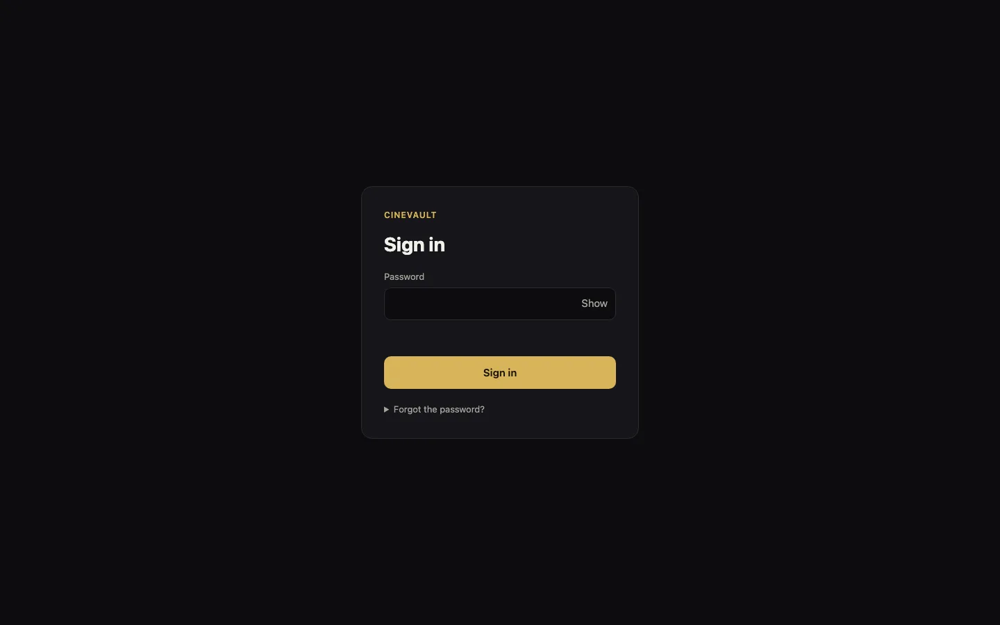
</picture>

Gardez-le sur votre réseau domestique ou derrière un VPN ; ne redirigez jamais son port vers Internet. Pas encore dans la bêta : les ordinateurs ARM (Raspberry Pi, NAS ARM) et « Ouvrir dans Kodi ». **[Le guide complet](packaging/README.fr.md)** détaille chaque étape, les commandes pour l'arrêter, le démarrer et le mettre à jour, un mot de passe oublié, les sauvegardes, l'installation à la main avec Docker ou les paquets, les [dossiers de bibliothèque sur un NAS](packaging/README.fr.md#dossiers-de-bibliothèque-sur-un-nas) et le dépannage.

L'application de bureau et le serveur peuvent partager un dossier de données, mais un seul à la fois peut l'ouvrir. Le serveur pose un verrou `library-owner.json` ; l'application de bureau refuse ce dossier et la ligne de commande `cinevault` se termine avec le code 2 au lieu d'écrire dans le dos du serveur.

## Captures d'écran

<table>
  <tr>
    <td width="50%" valign="top">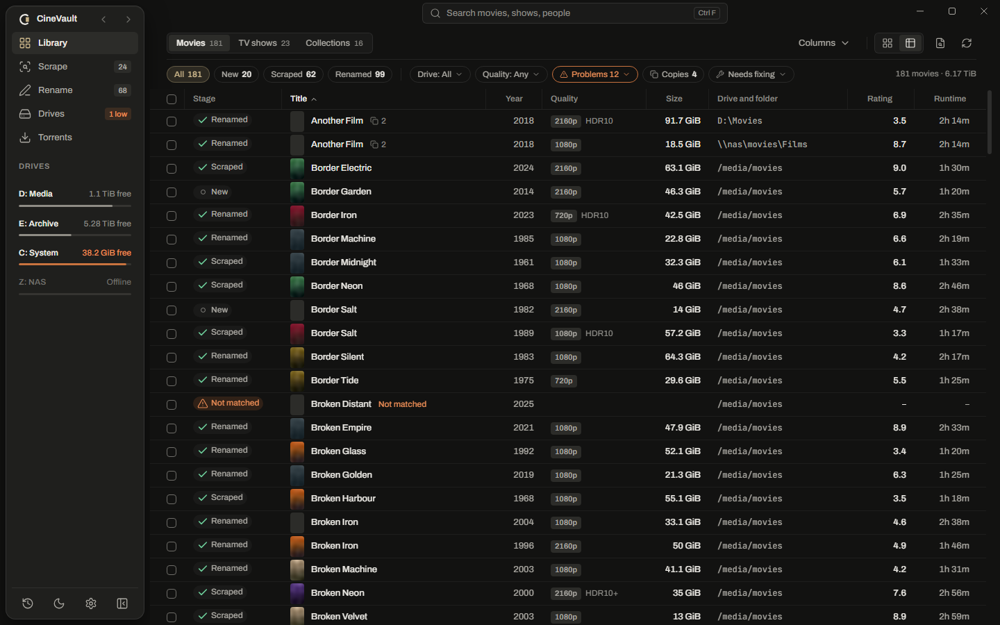<br><sub>Tableau de la bibliothèque : une colonne Étape, des colonnes déplaçables et redimensionnables</sub></td>
    <td width="50%" valign="top">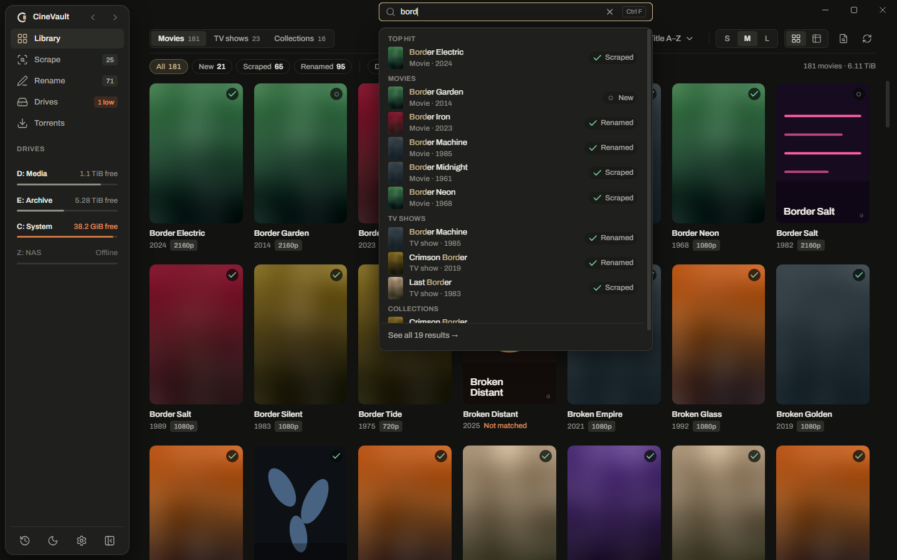<br><sub>Recherche au fil de la frappe, avec vos recherches récentes</sub></td>
  </tr>
  <tr>
    <td width="50%" valign="top">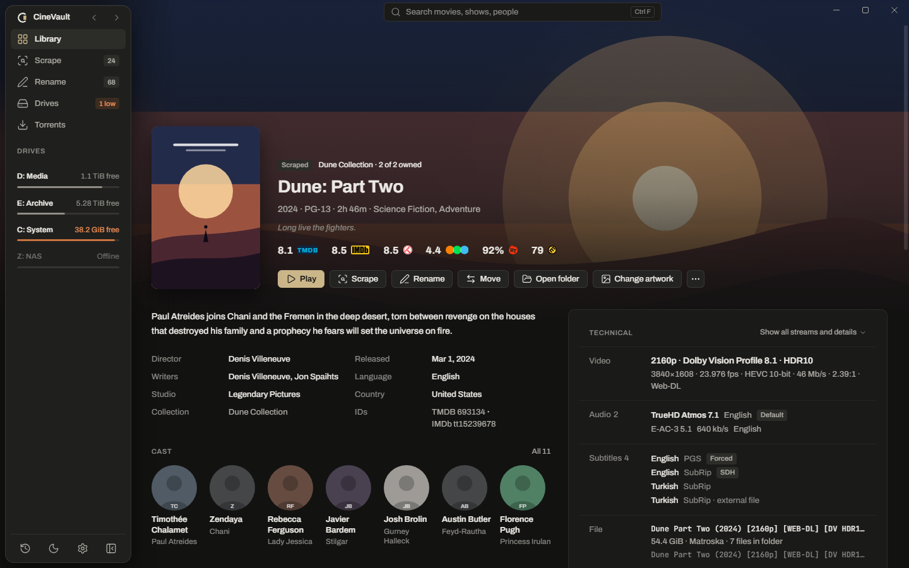<br><sub>Page du film : notes, distribution et carte Technique</sub></td>
    <td width="50%" valign="top">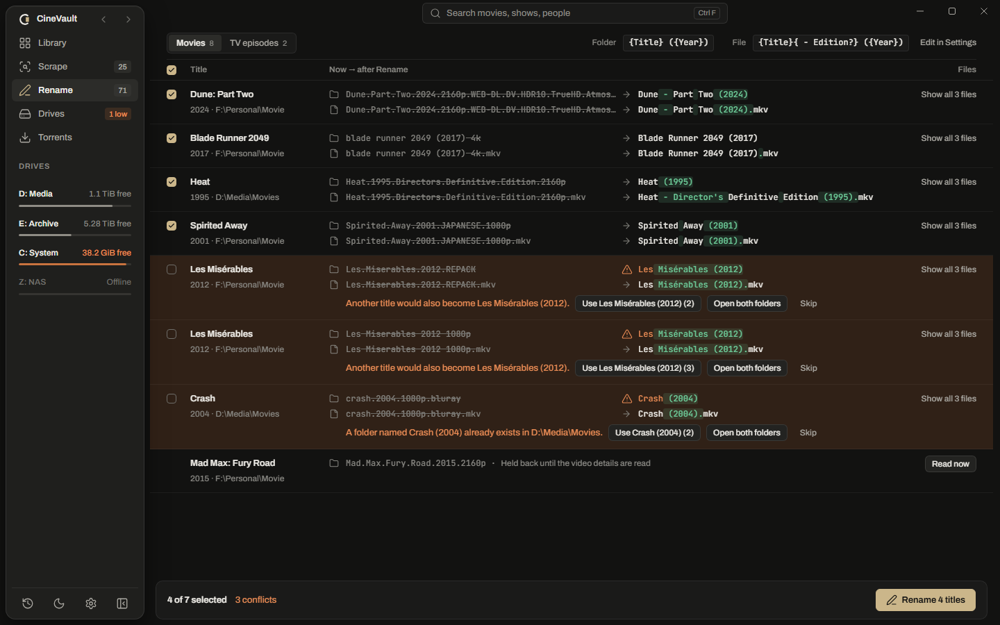<br><sub>Renommer : un aperçu mot à mot, les conflits résolus sur la ligne</sub></td>
  </tr>
  <tr>
    <td width="50%" valign="top">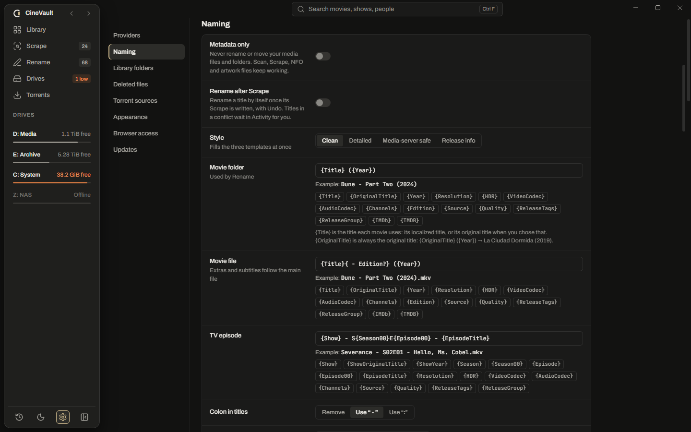<br><sub>Nommage : styles, noms des fichiers d'illustrations et Renommer après le scraping</sub></td>
    <td width="50%" valign="top">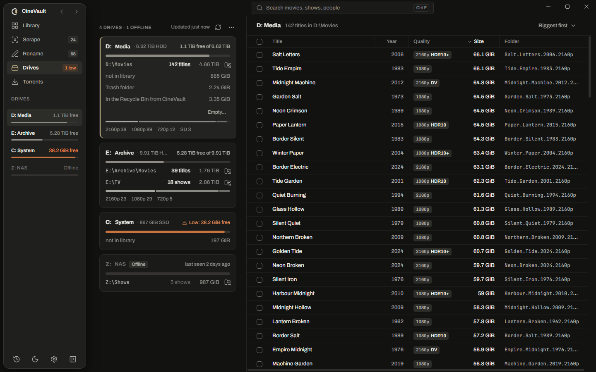<br><sub>Disques : espace libre et déplacements sûrs entre disques</sub></td>
  </tr>
  <tr>
    <td width="50%" valign="top">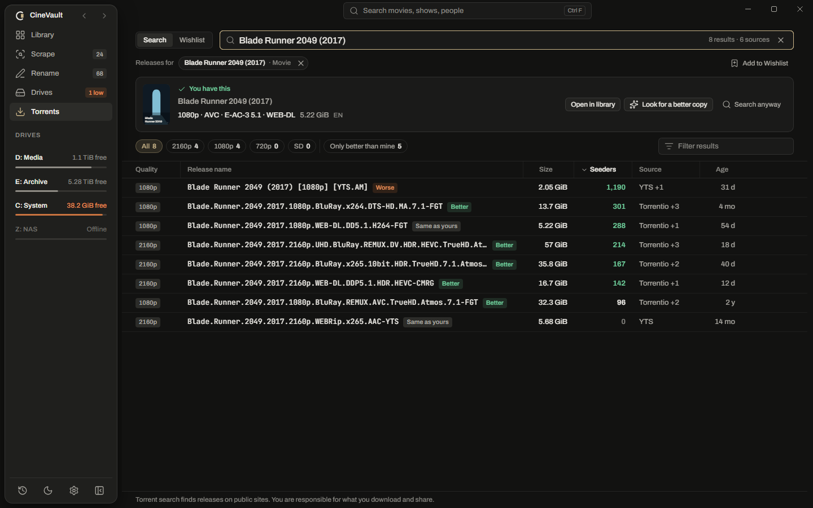<br><sub>Torrents : ce que vous avez, et si chaque release est meilleure</sub></td>
    <td width="50%" valign="top">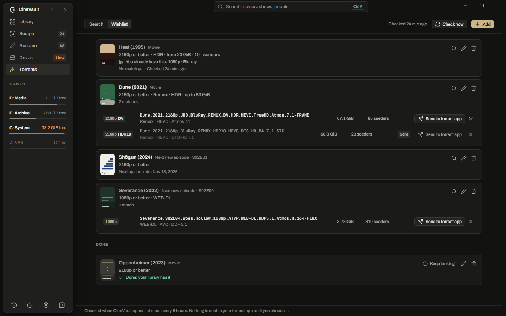<br><sub>Liste de souhaits : dites ce que vous voulez, voyez quand ça arrive</sub></td>
  </tr>
  <tr>
    <td width="50%" valign="top">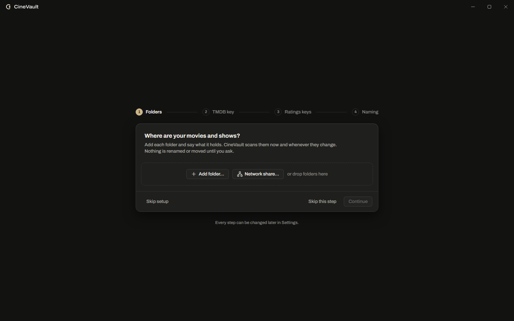<br><sub>Premier lancement : ajoutez vos dossiers, puis vos propres clés de fournisseurs</sub></td>
    <td width="50%" valign="top"></td>
  </tr>
</table>

<p align="center"><sub>Les captures sont réalisées avec la bibliothèque d'exemple intégrée à l'application (interface en anglais).</sub></p>

## Compiler depuis les sources

Il vous faut la chaîne d'outils [Rust](https://rustup.rs) stable (MSVC sous Windows), [bun](https://bun.sh) et les [prérequis de Tauri 2](https://v2.tauri.app/start/prerequisites/) (WebView2 sous Windows ; sous Linux, les paquets de développement WebKitGTK et `libdbus`).

```sh
bun install && (cd ui && bun install)
bun run tools:fetch      # MediaInfo, FFmpeg et outils annexes épinglés dans .dev-tools/
bun run tauri dev        # lancer l'application de bureau
bun run tauri build      # installateurs dans target/release/bundle/
```

Les vérifications à lancer avant une pull request sont listées dans [CONTRIBUTING.fr.md](CONTRIBUTING.fr.md).

## Contribuer

CineVault est open source et les contributions sont les bienvenues : rapports de bugs, idées, documentation et pull requests. Les questions et les idées ouvertes vont dans les [Discussions](https://github.com/imtheyoyo/CineVault-FR/discussions) ; le suivi des tickets est réservé aux bugs et aux fonctionnalités précises. Lisez d'abord [CONTRIBUTING.fr.md](CONTRIBUTING.fr.md) ; les contributeurs et les assistants de code IA suivent aussi [AGENTS.md](AGENTS.md). Chaque changement, y compris ceux du mainteneur, passe par une pull request depuis une branche, et la CI doit réussir avant la fusion. Merci de signaler les failles de sécurité en privé, comme décrit dans [SECURITY.md](SECURITY.fr.md).

## Licence

CineVault est distribué sous [licence Apache 2.0](LICENSE). Voir [NOTICE](NOTICE) et [THIRD_PARTY_NOTICES.md](THIRD_PARTY_NOTICES.md).

<sub>Ce produit utilise l'API TMDB mais n'est ni approuvé ni certifié par TMDB.</sub>
